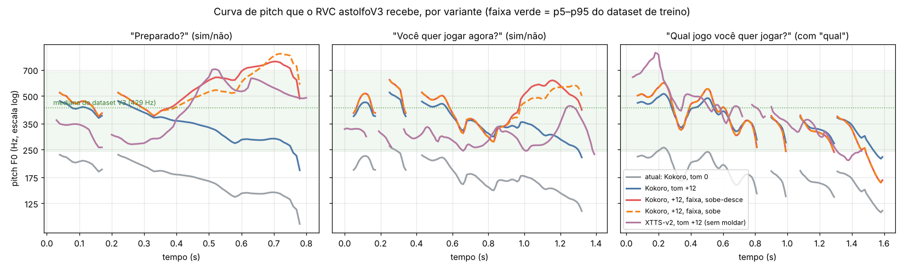

<!-- ! Alteração de IA - Revisar -->
# Voz da SennAI: por que soa robótica e o que melhora (23/10/2026)

Teste feito na máquina do Eric (GTX 1650, Ryzen 7 5800H), só com o modelo **astolfoV3** (RVC, Applio).
Scripts: `bench/voz_frases_tts.py`, `bench/voz_xtts.py`, `bench/voz_prosodia_rvc.py`.
Áudios: `bench/audio/prosodia/`. Curvas de pitch: `bench/resultados/prosodia_f0*.npz` e `docs/pesquisa/img/curvas_f0.png`.

## Resumo

O RVC não cria entonação: ele troca o timbre e **copia a curva de pitch (F0) do áudio de entrada**.
Medido com Praat/RMVPE, a saída do RVC segue a entrada quase ponto a ponto (o "Preparado?" do Kokoro cai −2,6 semitons e a saída do RVC também cai −2,6 a −3,1). Ou seja, os dois problemas que o Eric ouviu vêm de antes do RVC e de como ele é chamado:

1. **Tom errado.** O dataset de treino do V3 (amostra de 72 trechos do `f0_voiced` no Drive) tem mediana de **429 Hz** (p5–p95: 243–685 Hz, desvio de 5,6 semitons). O Kokoro `pf_dora` entra em **~175 Hz** e o teste rodava com `pitch = 0`. O modelo estava trabalhando **~15 semitons abaixo** da região que aprendeu. É o caso típico de voz "abafada/robótica" no RVC, e explica por que ele canta bem: nas músicas a voz de entrada já estava na região certa.
2. **Entonação pobre na fonte.** O Kokoro em pt-BR fala tudo como afirmação: "Preparado?" cai −7,6 st no fim, "Você quer jogar agora?" também cai −7,6 st. A faixa melódica dele (desvio 2,6–3,7 st) é bem menor que a do dataset (5,6 st). O RVC herda essa fala "de URA".

## O que foi testado

As frases são geradas uma por arquivo (como vai ser no streaming do LLM), convertidas no RVC e emendadas.
A entonação é corrigida **dentro do RVC**: um gancho em `Pipeline.get_f0` mexe na curva de pitch antes da síntese. Como o RVC sintetiza direto na curva nova, não aparece o chiado típico de quem estica o pitch do áudio depois.

| Arquivo (`bench/audio/prosodia/`) | O que muda |
|---|---|
| `v0_atual.wav` | Igual ao teste anterior: Kokoro, pitch 0, index 0,30, protect 0,33 |
| `v1a_tom8.wav`, `v1b_tom12.wav`, `v1c_tom15.wav` | Só o tom: +8, +12, +15 semitons |
| `v2_tom_faixa.wav` | +12 e faixa melódica ×1,4 (mais "sobe e desce" em volta da mediana) |
| `v3_tom_faixa_entonacao.wav` | v2 + curva por tipo de frase: pergunta de sim/não sobe na tônica e cai um pouco no fim (padrão do português do Brasil); afirmação e pergunta com "qual/que/quem" caem no fim; exclamação um pouco mais aguda |
| `v4_entonacao_sobe.wav` | Como v3, mas a pergunta sobe até o fim (mais "anime") |
| `v5_v3_index060.wav` | v3 com index 0,60 (mais timbre do dataset, risco de sotaque) |
| `v6_v3_protect050.wav` | v3 com protect 0,50 (menos proteção das consoantes) |
| `v7_piper_entonacao.wav` | v3 com o Piper `faber` como fonte no lugar do Kokoro |
| `v8_xtts_tom12.wav` | **XTTS-v2** como fonte (falante "Ana Florence"), +12, sem mexer na curva |
| `v9_xtts_entonacao.wav` | v8 com faixa e curva por tipo de frase |

Frases: "Oi!", "Eu sou a SennAI.", "Hoje a gente vai jogar um pouquinho e depois, quem sabe, tocar uma música juntos.", "Preparado?", "Você quer jogar agora?", "Qual jogo você quer jogar?", "Nossa, que jogada incrível!".



### Números

| Medida | Kokoro (atual) | XTTS-v2 |
|---|---|---|
| "Preparado?" no fim | −7,6 st (cai) | **+11,0 st (sobe)** |
| "Você quer jogar agora?" no fim | −7,6 st (cai) | **+6,2 st (sobe)** |
| Desvio do pitch na frase longa | 2,6 st | 3,2 st |
| Velocidade (RTF) | 0,34 na CPU | 0,6 na GTX 1650 |
| Memória de vídeo | nenhuma (CPU) | **2,3 GB de VRAM** |

RVC: ~0,5 s por frase na GTX (aquecido; 3,5 s para as 7 frases). Com o tom +12, a mediana da saída vai de 179 Hz para 356 Hz, dentro da faixa do dataset. Com faixa ×1,4 o desvio vai de 3,3 para 4,3 st.

## Limites deste teste

- **Eu não consigo ouvir os áudios.** As conclusões acima são medidas de pitch, não de qualidade de timbre. A escolha final é de ouvido, do Eric.
- O "sobe-desce" usa uma janela fixa de 0,45 s no fim da frase como "última palavra". Funciona para palavras paroxítonas (a maioria), mas pode errar a tônica em oxítonas ("você", "jogar"). Uma versão melhor usaria o tempo das palavras do TTS.
- Em "Preparado?" a subida chega a ~750 Hz, acima do p95 do dataset. Se soar esganiçado, baixar `subida` de 7 para 5.
- O dataset de F0 é uma amostra (72 trechos, ~160 s). As 2 músicas do Eric servem para confirmar a região de canto, mas não mudam a conclusão.

## Recomendação

1. **Já: tom +12 no RVC para qualquer fonte de ~175 Hz.** É a mudança barata de maior efeito esperado, sem custo de tempo. Ouvir `v1a/v1b/v1c` e escolher entre +8, +12 e +15.
2. **Já: moldar a curva por tipo de frase dentro do RVC** (`moldar()` em `voz_prosodia_rvc.py`). Resolve o "Preparado?" com qualquer TTS e custa quase nada. Comparar `v3` e `v4` para escolher o estilo da pergunta.
3. **A testar de ouvido: trocar o Kokoro pelo XTTS-v2.** Ele já faz pergunta subir sozinho e varia mais o ritmo. O custo é 2,3 GB de VRAM: XTTS + RVC (~1,3 GB) ocupam ~3,6 dos 4 GB da GTX 1650, então no modo Jogando não cabem juntos. Ou seja, XTTS serve para o modo conversa/música, e no modo jogo fica Kokoro + curva moldada. A licença do XTTS-v2 (Coqui Public Model License) só permite uso não comercial, o que serve para o TCC.
4. **Se ainda faltar naturalidade:** testar o Chatterbox Multilingual (licença MIT, tem pt e um controle de "exagero" de emoção) ou o F5-TTS com ajuste em pt-BR. Os dois precisam de um áudio de referência, e o XTTS não precisa.

## Como reproduzir

```powershell
cd bench
.venv\Scripts\python.exe voz_frases_tts.py          # Kokoro e Piper (o Kokoro precisa rodar na CPU: no DirectML ele quebra)
.venv-xtts\Scripts\python.exe voz_xtts.py           # XTTS-v2 (venv próprio, modelo em modelos\xtts)
applio\.venv\Scripts\python.exe voz_prosodia_rvc.py 12                               # todas as variantes Kokoro/Piper
applio\.venv\Scripts\python.exe voz_prosodia_rvc.py 12 v8_xtts_tom12,v9_xtts_entonacao
```
